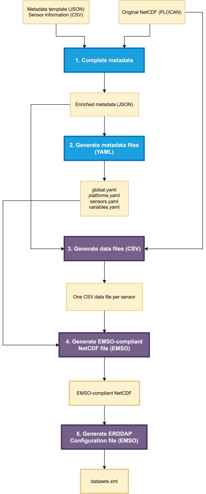

# ERDDAP Workflow Pipeline

This repository hosts an automated pipeline to convert existing NetCDF files to EMSO-compliant files based on the latest [EMSO Metadata Specifications](https://github.com/emso-eric/emso-metadata-specifications/tree/develop). The system integrates tools for extraction, metadata enrichment under **EMSO/OceanSites** standards, and automatic generation of ERDDAP configuration files.


## IMPORTANT

### JSON metadata template and CSV with sensor information

This script takes a **JSON metadata template** (following EMSO Metadata Specifications) and a **CSV with sensor metadata** as input besides the original NetCDF. You can find an example of the files we use at PLOCAN to convert our data in the `examples` folder, but you should generate these files for your own institution. More information on **how to generate the JSON metadata template and the CSV with sensor information** for your own institution can be accesed on the [**`complete_metadata` tool README**](https://github.com/plocan-data/Utils/blob/main/complete_metadata/README.md).

### Dataset ID generation logic
 This pipeline includes a function to automatically generate the name of the final NetCDF and XML files based on the variables, start and end date, and depth. However, the ID generation logic includes a hard-coded prefix to reference our platform (`OS_ESTOC_`) and data mode (`D`) of our files. You might want to change them directly in the code (go to **line 80 in `netcdf_pipeline.py`**) to adapt it to your institution and different data mode.


## Pipeline Steps

> **Note:** All the steps included in this pipeline can be executed on standalone mode. 


<div align="center">
  
</div>


## Project Structure

```text
erddap_workflow/
├── netcdf_pipeline.py           # Main script
├── external/
│   ├── metadata-harmonizer/   # Submodule: EMSO tools (NetCDF Generator, ERDDAP Configurator)                
│   └── Utils/ # Submodule: Processing tools (Export Metadata, Complete Metadata, Generate YAML metadata files, Generate CSV data files)
│        ├── extract_metadata/
│        │    └── extract_metadata.py
│        ├── complete_metadata/
│        │    ├── complete_metadata.py
│        │    ├── emso_template.json
│        │    └── sensor_metadata.csv
│        ├── netcdf_to_csv/
│        │    └── netcdf_to_csv.py
│        └── yaml_generator/
│             └── yaml_generator.py
│
└── requirements.txt           # Project dependencies
```

## Installation & Setup

### 1. Clone the repository with submodules
To fetch the main code along with all required external tools:

```bash
git clone --recurse-submodules https://github.com/plocan-data/erddap_workflow.git
cd erddap_workflow
```

### 2. Install dependencies
It is recommended to use a virtual environment with Python 3.11 installed:

```bash

pip install -r requirements.txt

```

### 3. Update submodules
When pulling the latest changes from the main repository, you should also update the submodules to ensure they match the current project state:

```bash

git pull --recurse-submodules

``` 

## Pipeline Workflow

Run the main script:

```bash

python netcdf_pipeline.py

```

A series of graphical windows will open for you to select the original .nc file, the JSON metadata template, the CSV with sensor information, and the output directory.

### Steps

1. **Input Selection:** Select the original .nc file, the template.json, the sensors.csv, and the target output directory.
2. **Step 1 (Metadata):** The script extracts original metadata and completes them using the JSON template, generating an enriched JSON.
3. **Step 2 (YAMLs):** Generation of YAML metadata files required by the Metadata Harmonizer tool.
4. **Step 3 (CSVs):** Data extraction from the original NetCDF into standardized tabular CSV files.
5. **Step 4 (Harmonizer):** Execution of the EMSO Generator to fuse CSV data and YAML metadata into a final NetCDF.
6. **Step 5 (ERDDAP XML):** Generation of the datasets.xml file using the -o flag for direct file output.


## Output
A workflow folder will be generated for every NetCDF file processed in your target output directory. Inside this folder, the following files will be generated:

* **JSON file with enriched metadata**
* **Directory with four YAML metadata files** (global.yaml, platforms.yaml, variables.yaml, and sensors.yaml).
* **One or more CSV files (one for every sensor)**
* **Final EMSO-compliant NetCDF file**
* **ERDDAP configuration XML file**


## Additional tools

This repo includes an additional tool (`emso_netcdf_xml_generator`) that automatically executes Step 4 and 5 of `netcdf_pipeline.py` (`generator.py` and `erddap_config.py of EMSO Metadata Harmonizer tool`). This tool is useful when the necessary CSV and YAML files have already been generated outside of the main pipeline contained in this repo. 